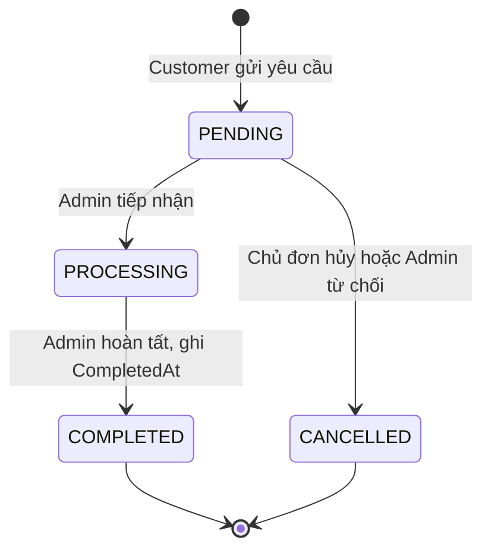

# Bàn giao P3 — dịch vụ và quản lý đơn

Ngày kiểm tra: **30/10/2026**. P3-01 đến P3-07 đã triển khai và kiểm tra;
**người dùng đã xác nhận nghiệm thu P3 ngày 30/10/2026**. P1/P2 có đủ phần bàn giao để tích hợp.
Lượt P3-07 chỉ bổ sung kiểm tra, bằng chứng và tài liệu; không sửa mã chạy ứng dụng.

## Chức năng đã ghép

Customer chọn dịch vụ từ catalog P2, gửi một yêu cầu với 0..n linh kiện,
xem lịch sử riêng, hủy khi PENDING và đánh giá một lần khi COMPLETED.
Admin lọc đơn, tiếp nhận/hủy, ghi chú hiện tại, hoàn tất và xem thống kê.
Trang dịch vụ P2 đọc đánh giá đã lưu từ chính các đơn này.

| Route | Quyền | Hành vi |
|---|---|---|
| `/services?id=...#reviews` | Public | Catalog, giá hiện tại, tên khách và đánh giá |
| `/request?serviceId=...` | CUSTOMER active | GET form; POST `action=create` |
| `/orders` | CUSTOMER active | GET lịch sử; POST `cancel` hoặc `review` |
| `/admin/orders?status=...` | ADMIN active | GET danh sách/lọc; POST `status` hoặc `note` |
| `/admin/dashboard` | ADMIN active | GET số lượng theo trạng thái, tổng giá trị COMPLETED |

Các form POST dùng CSRF P1. Create có thêm token một lần và đồng bộ theo session;
token chỉ tiêu sau khi lưu thành công, rồi redirect về lịch sử. Giá, owner, role,
trạng thái và snapshot được xác định ở server. DAO đọc giá/active trong cùng
transaction với INSERT ServiceOrder/OrderDetail, dùng getGeneratedKeys và rollback.



UPDATE kiểm tra trạng thái nguồn/owner và số dòng ảnh hưởng. Review yêu cầu
owner + COMPLETED + chưa review; UNIQUE(OrderID) và khóa SQL chặn ghi trùng.
Không sửa/xóa/reply review. Tổng trên dashboard là **giá trị đơn hoàn tất**;
không có nghiệp vụ thanh toán, kho, QC, báo giá phát sinh hoặc bảo hành.

## File và nền tảng

P3 có `model/Order`, `model/OrderDetail`, `dao/OrderDAO`,
`controller/OrderServlet`, `controller/orders/OrderSupport`,
`controller/admin/AdminOrderServlet`, `controller/admin/AdminDashboardServlet`.
View chính: `request-form.jsp`, `request-history.jsp`, `admin/orders.jsp`,
`admin/dashboard.jsp`; CSS/JS tại `web/css/orders.css`, `web/js/orders.js`.

Tái sử dụng DBContext, Account/session, AuthFilter, CSRF và layout P1;
ProductDAO/ServiceDAO/model.ServiceReview và public services.jsp của P2.
Servlet gọi DAO trực tiếp; JavaBean/JSP/JSTL; không Maven/service layer/DTO/enum.
Source có 25 file Java, WAR có 25 class Java 17 (major 61) và 3 JAR JDBC/JSTL.
Giữ nguyên schema 8 bảng SQL Server, không tạo lại/xóa database.

## Kết quả kiểm tra thực tế

Ant `clean dist` thành công bằng JDK 17.0.12 và Ant của NetBeans 17.
WAR đã deploy vào Tomcat **10.1.59**, context `/KeebForce`, connector riêng
`127.0.0.1:18080`; SQL Server local là 17.0.1000.7.

| Bộ kiểm tra | Đạt | Nội dung chính |
|---|---:|---|
| [P3-01](verification/p3/VerifyP301.txt) | 22 | Model/getter/list/detail và fixture transaction rollback |
| [P3-02](verification/p3/VerifyP302.txt) | 33 | Form, ID/service active, contact/date/quantity, layout và quyền |
| [P3-03](verification/p3/VerifyP303.txt) | 64 | Giá DB, snapshot, rollback lỗi SQL thật, token/double click, CSRF/locked |
| [P3-04](verification/p3/VerifyP304.txt) | 51 | History/owner, hủy có điều kiện, lặp và đồng thời |
| [P3-05](verification/p3/VerifyP305.txt) | 70 | Admin/filter/note, chuyển trạng thái, CompletedAt, thống kê/race |
| [P3-06](verification/p3/VerifyP306.txt) | 60 | Review owner/completed/unique, validation/escape, tích hợp P2 |
| [P3-07](verification/p3/VerifyP307.txt) | 43 | HTTP toàn luồng, khóa account qua P1, outage và SQL sau thao tác Chrome |
| [Jasper Tomcat](verification/p3/jasper.txt) | 0 lỗi | Biên dịch JSP/tag bằng source/target 17 |

Tổng **343 kiểm tra JDBC/HTTP**. Các lượt race chạy đồng thời trong các bộ kiểm tra;
không suy rộng kết quả này thành chống trùng trên mọi thiết bị.
P3-02 được chỉnh bài kiểm tra POST thiếu dữ liệu để gửi token create hợp lệ,
đúng hợp đồng bổ sung ở P3-03. Không đổi validation ứng dụng để làm test qua.

P3-07 đăng ký hai account fixture qua AuthServlet, đặt đơn qua HTTP, Admin xử lý,
khách review; sau đó lặp toàn luồng bằng form thật trong Chrome với context cookie
riêng Customer/Admin. SQL xác nhận hai đơn COMPLETED, mỗi đơn 3 chi tiết,
2.050.000₫, CompletedAt khác NULL, đúng một review 5 sao. Hai đơn chỉ dịch vụ
200.000₫ được hủy bởi Customer/Admin; không có detail/CompletedAt.
Public đọc 2 đánh giá, trung bình 5.0; dashboard có 4 đơn, 2 completed,
2 cancelled, tổng completed **4.100.000₫**.

Thử account bị khóa bằng route quản lý tài khoản P1: session cũ không xem/ghi đơn.
Thử DB outage chỉ bằng config của Tomcat thử riêng: bốn GET và một POST trả 503
thân thiện, không lộ SQLException/JDBC; khôi phục config thì route hoạt động lại.
Rollback SQL thật được kiểm tra ở P3-03 bằng khóa bảng detail/lock timeout;
không để parent nửa chừng. Không giả danh sách đơn/review trong ứng dụng.

## Bằng chứng giao diện

10 ảnh chụp từ dữ liệu do các route thật tạo, trước khi dọn fixture:

1. [Catalog dịch vụ](screenshots/p3/01-services-desktop.png).
2. [Form và tổng ước tính 2.050.000₫](screenshots/p3/02-request-desktop.png).
3. [Lịch sử PENDING sau submit](screenshots/p3/03-history-pending.png).
4. [Admin đang xử lý và ghi chú](screenshots/p3/04-admin-processing.png).
5. [Đơn hoàn tất có form đánh giá](screenshots/p3/05-review-form.png).
6. [Lịch sử đã đánh giá, form không còn](screenshots/p3/06-history-reviewed.png).
7. [Đánh giá public](screenshots/p3/07-public-reviews.png).
8. [Dashboard 4.100.000₫](screenshots/p3/08-dashboard.png).
9. [Public mobile giả lập 390px](screenshots/p3/09-public-reviews-mobile.png).
10. [History mobile giả lập 390px](screenshots/p3/10-history-mobile.png).

Đã bấm link header/catalog/public review và gửi form native create/status/note/review.
Link/form đã quan sát dùng đúng context `/KeebForce`. Desktop không tràn ngang;
public/history mobile có page width 390px, bảng detail cuộn trong khung 298px
với nội dung 600px. Xem [kết quả Chrome](verification/p3/browser-summary.json).

Sau toàn bộ kiểm tra, SHA-256 của nội dung mọi dòng trong 8 bảng khớp baseline;
chỉ dọn đúng account/order/detail/review fixture. Số dòng cuối là
`3/3/5/10/4/0/0/0` theo UserAccount/Brand/Category/Product/WorkshopService/
ServiceOrder/OrderDetail/ServiceReview. IDENTITY có thể có khoảng trống sau test;
không reseed/reset. Vì fixture đã dọn, ID đơn trong ảnh không còn trong DB.
Xem [regression summary](verification/p3/regression-summary.json),
[SQL cuối](verification/p3/final-sql-counts.txt),
[audit source](verification/p3/static-audit.json).

## Build và chạy lại kiểm tra

Mở project bằng NetBeans 17, JDK 17 và Tomcat 10.1; theo [setup](setup.md) để
cấu hình DB và context. Với DB hiện có, giữ nguyên DB, không chạy lại script tạo/seed.

```powershell
& 'C:\Program Files\NetBeans-17\netbeans\extide\ant\bin\ant.bat' '-Dj2ee.compile.on.save=false' clean dist
# Khởi động WAR trên Tomcat với cấu hình DB local trước khi chạy HTTP test.
powershell.exe -NoProfile -ExecutionPolicy Bypass -File test/VerifyP307.ps1 -BaseUrl http://127.0.0.1:18080/KeebForce
# Runner vừa compile các test. Lượt toàn luồng tự dọn fixture:
& 'C:\Program Files\Java\jdk-17\bin\java.exe' '-Dfile.encoding=UTF-8' '-Dkeebforce.db.config=config/db.properties' -cp 'build/verify-p307;build/web/WEB-INF/classes;web/WEB-INF/lib/*' VerifyP307 http://127.0.0.1:18080/KeebForce
```

Runner kiểm tra các seed demo hiện có; không chạy đồng thời với người dùng sửa DB.
Lượt mặc định toàn luồng là 32 checks; lượt đã chạy 43 còn có 6 outage + 5 SQL
kiểm chứng thao tác Chrome. Muốn tái hiện phần Chrome, truyền đối số thứ hai `-`
rồi `--preview`, hoàn tất thêm một đơn 2.050.000₫/3 linh kiện/5 sao bằng browser,
sau đó Enter để kiểm SQL và dọn. Chỉ truyền đường dẫn config outage nếu đó là
`keebforce-p307-.../conf/keebforce-db.properties` của Tomcat thử riêng.
Không ngắt tiến trình trong khi fixture còn tồn tại.

Jasper CLI phải đưa thư mục output vào classpath để resolve class sinh từ money.tag.
Không dùng Jasper cũ của target NetBeans `compile.jsps=true` với sourceVM 17.

WAR bàn giao: `dist/KeebForce.war`, **5.724.958 bytes**, SHA-256:
`F38F4F4B2569D0D218BBF3BB16DFD765F6D163EF333C73B6E8F501A0851F472E`.
[Manifest kiểm tra](verification/p3/artifact-summary.json) xác nhận không có config
mật khẩu, SQL, Java/test source hoặc DLL trong WAR. Test/docs/screenshots nằm ngoài WAR.

## Phạm vi chưa kiểm tra và nghiệm thu

Chưa thao tác Run bằng giao diện NetBeans, chưa chạy trên máy thành viên khác hoặc
điện thoại vật lý. Mobile là giả lập Chrome. Chưa mô phỏng mất mạng chính xác lúc
commit hoặc thử tải dài hạn; outage protected route được Filter xử lý trước servlet.
History/admin đơn chưa phân trang; token create chỉ dành cho form mới nhất của session.
Ghi chú Admin hiện tại có thể được lần lưu sau ghi đè, đúng phạm vi một note.

Đã đối chiếu đủ 8 mục acceptance của requirement P3: package đơn giản; form một
service/0..n product; giá/snapshot/transaction; owner/role; bốn trạng thái; note/dashboard;
review/HTML/CSRF/PreparedStatement; báo cáo và bằng chứng thật. Đây là kết quả kiểm tra
của người thực hiện; người dùng đã xác nhận “xác nhận nghiệm thu p3” sau khi sửa
lỗi ký hiệu tiền ở form yêu cầu. Các giới hạn kiểm tra nêu trên vẫn được giữ nguyên.
Không git add/commit/push/PR. P3 kết thúc ngày 30/10/2026.
